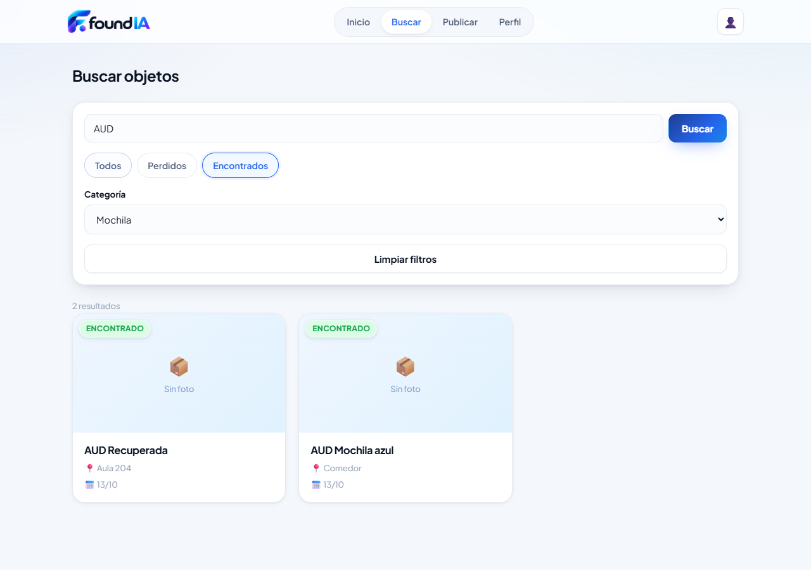
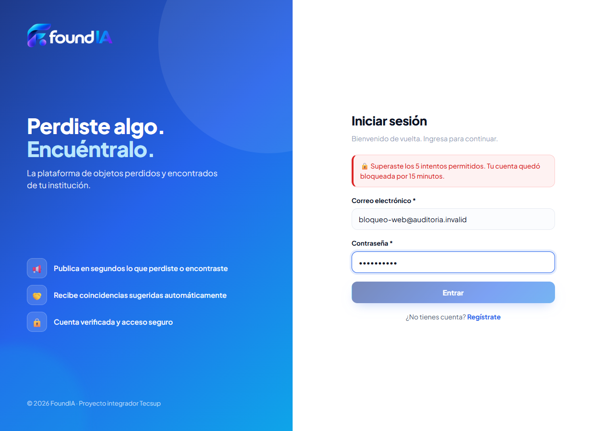
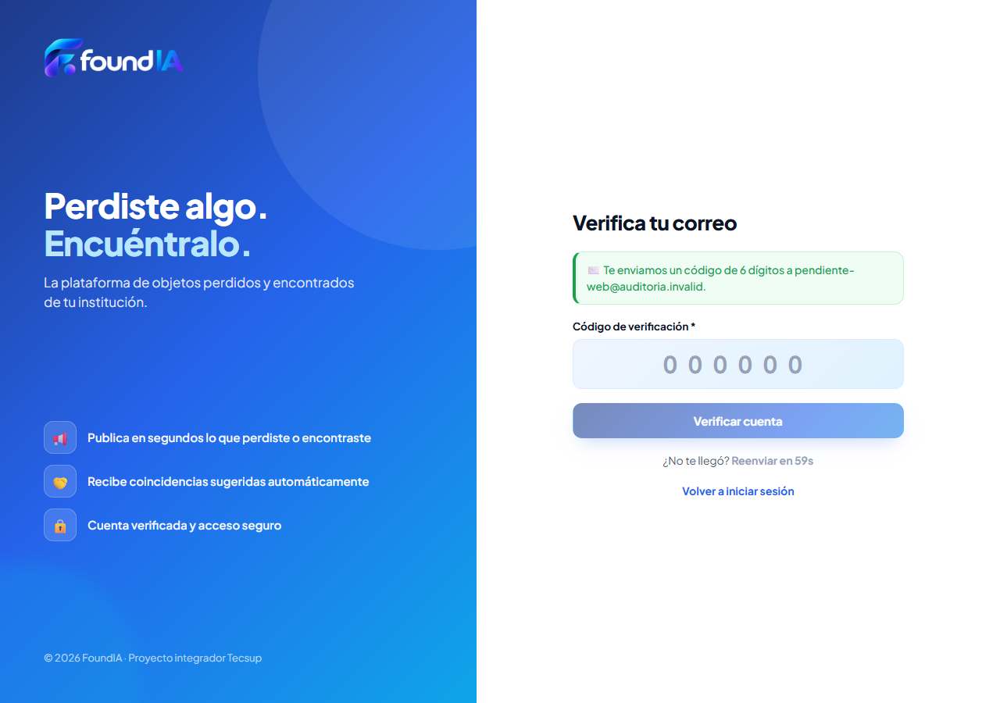
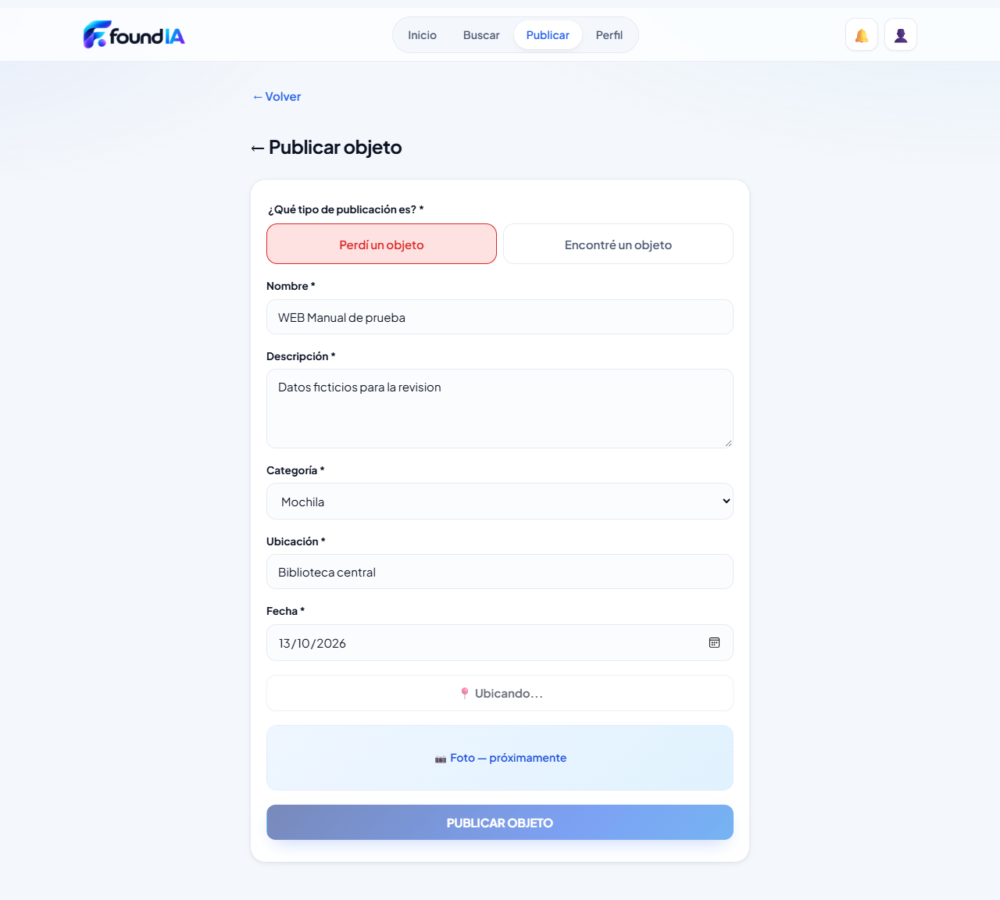

# FoundIA — Revisión de cierre del Sprint 1

**Fecha:** 13 de octubre de 2026  
**Rama revisada:** `frontend/web`  
**Código revisado:** `143decf` — Integrar logo FoundIA en frontend web  
**Alcance:** H1, H3, H4, H6, H7, H11 y H12, más comprobaciones complementarias de integración administrativa.  
**Modalidad:** revisión y documentación; no se aplicaron correcciones al código de la aplicación.

## 1. Resultado ejecutivo

**El Sprint 1 está implementado, pero quedan cuatro defectos funcionales dentro
de las historias revisadas. Todavía no se recomienda marcarlo como cerrado.**
También se observó una diferencia de bloqueo entre Spring y Django que requiere
una decisión de alcance del equipo.

| Nivel | Ejecutadas | Correctas | Fallidas |
| --- | ---: | ---: | ---: |
| HTTP/API real con MySQL y SMTP | 45 | 43 | 2 |
| Navegador real con API y MySQL | 40 | 37 | 3 |
| **Total de comprobaciones de esta auditoría** | **85** | **80** | **5** |

Una comprobación puede agrupar varias entradas inválidas o varios endpoints.
Los conteos no deben presentarse como 85 historias ni como 85 pruebas unitarias.

La regresión automatizada del mismo código pasó previamente durante esta
revisión: **131 pruebas backend** y **47 pruebas frontend**, sin fallos.
Los builds de ambos frontends y `py manage.py check` también fueron correctos.
Esas suites no cubren todos los defectos encontrados en esta auditoría.

El resultado individual de las 85 comprobaciones, los tiempos de ejecución y
las observaciones están en
[resultados.json](evidencias-sprint1-2026-10-13/resultados.json).

## 2. Entorno y método

Se mantuvieron los contenedores que el usuario ya tenía funcionando. Para la
auditoría se prepararon una MySQL y una bandeja Mailpit independientes, con el
esquema y seed del repositorio y únicamente cuentas/publicaciones ficticias.

| Componente | Configuración comprobada |
| --- | --- |
| MySQL | 8.0.46, contenedor de prueba, puerto `13306` |
| Esquema | `database/script.sql` y `database/seed.sql`, 8 tablas; seed: 4 usuarios, 8 categorías y 6 objetos |
| Spring Boot | Java 17, jar construido desde el código revisado, puerto `18081` |
| Django administrativo | Código revisado, misma base aislada, puerto `18000` |
| Frontend usuario | Vite, puerto `15173`, API `18081` |
| Frontend admin | Vite, puerto `15174`, API `18000` |
| Mailpit | SMTP `11025`, bandeja HTTP `18025` |
| Navegador | Microsoft Edge `155.0.4283.45`, automatizado con Playwright en modo headless |
| Tamaños de pantalla | Escritorio `1280 × 900` y móvil `360 × 800` |

### Qué fue real y qué se controló

- Registro, verificación, login, publicaciones, consultas, moderación y
  persistencia se comprobaron contra los backends reales y MySQL real.
- Los códigos se enviaron por SMTP a Mailpit y se leyeron de los mensajes
  recibidos. Para comprobar el fallo de correo se detuvo temporalmente solo el
  Mailpit de prueba: la API respondió con un `503` real.
- La posición GPS se proporcionó mediante la emulación del navegador. La
  respuesta de Nominatim se controló para probar dirección correcta, `503` y
  lentitud. Esto no certifica sensores físicos ni disponibilidad del proveedor.
- La expiración del bloqueo se adelantó solo en la cuenta de prueba. Antes de
  comprobar el botón del navegador se verificó que la API ya permitía el login.
  No se esperaron 15 minutos reales.
- Los fallos de búsqueda/catálogo se inyectaron como respuestas HTTP `503` en
  el navegador; después se retiró esa intervención y se comprobó el reintento
  contra la API real.
- Se verificó ausencia de desbordamiento horizontal en cinco pantallas a
  `360px`. Es una comprobación responsive básica, no una certificación completa
  de accesibilidad ni de todos los dispositivos.

## 3. Estado por integrante e historia

El reparto corresponde a la documentación actual de `docs/pruebas/`.

| Integrante | Historia | Estado observado | Evidencia principal |
| --- | --- | --- | --- |
| Amore | H1 — Registrar objeto | Flujo principal y validaciones correctos | API-21, API-23, API-24, API-27, API-28; UI-11 y UI-12 |
| Amore | H3 — Ubicación | Funciona ubicación manual, GPS y edición; pendiente R04 por geocodificación lenta | API-22 y API-26; UI-14 a UI-18 |
| Amore | H4 — Fecha | Fecha actual/pasada aceptada y futura rechazada | API-25; UI-12, UI-13 y UI-39 |
| Leonel | H6 — Buscar objetos | Correcto en los escenarios ejecutados | API-29 a API-32, API-36 a API-38; UI-19, UI-22, UI-29 a UI-33, UI-37 y UI-38 |
| Leonel | H7 — Filtrar por categoría | Correcto en los escenarios ejecutados | API-33 a API-35 y API-38; UI-20 a UI-28, UI-30 y UI-32 |
| Yajaira | H11 — Registro y verificación | Flujo normal correcto; pendientes R02 y R03 | API-02 a API-11 y API-44; UI-02 a UI-04, UI-08 a UI-10 y UI-40 |
| Yajaira | H12 — Iniciar sesión | API y bloqueo correctos; pendiente R01 en recuperación de la pantalla | API-12 a API-20; UI-01, UI-05 a UI-07 |
| Equipo / administración | Integración Django–Spring | Login, dashboard, permisos y moderación correctos; diferencia R05 en bloqueo compartido | API-41 a API-43 y API-45; UI-34 |

## 4. Búsquedas y filtros comprobados

Las consultas se comprobaron por contenido e identidad de los resultados,
no únicamente por recibir `200`.

| Escenario | Resultado | Casos |
| --- | --- | --- |
| Texto parcial, mayúsculas y espacios externos | Correcto | API-29, UI-19 y UI-22 |
| Texto presente en descripción o ubicación | Correcto | API-30 y API-31 |
| Texto + categoría + tipo | Intersección correcta; no suma resultados de filtros distintos | API-32, UI-21 y UI-22 |
| Categoría en listado, búsqueda y endpoint dedicado | Solo resultados de esa categoría | API-33 y UI-20 |
| Categoría inexistente o parámetro inválido | `404` / `400`, sin error interno | API-34 y UI-28 |
| Categoría existente sin publicaciones | `200` y lista vacía, estado vacío en pantalla | API-35 y UI-26 |
| Categoría desactivada | Conserva publicaciones públicas anteriores y se identifica en el selector | API-35 y UI-27 |
| Seleccionar “Todas” | Quita solo categoría; conserva texto y tipo | UI-24 |
| Limpiar filtros | Limpia URL, controles y resultados | UI-25 |
| Atrás y Adelante | Restablece filtros y selector | UI-30 |
| `%`, `_` y `!` | Búsqueda literal, sin comodines SQL | API-36 y UI-29 |
| Sin coincidencias | Lista vacía y mensaje correspondiente | API-37, UI-23 y UI-26 |
| Publicaciones ocultas/eliminadas | No aparecen; detalle y coincidencias devuelven `404` | API-38 |
| Orden | Fecha descendente e id descendente en empates | API-38 |
| Filtro anterior con respuesta lenta | No reemplaza los resultados del filtro nuevo | UI-38 |
| Búsqueda desde Inicio con ubicación | Conserva texto/categoría/ubicación en URL y filtra correctamente | UI-37 |
| Error de búsqueda + reintento | Error separado de lista vacía; reintento correcto | UI-31 |
| Error de catálogo + reintento | Resultados independientes, selector deshabilitado y recuperación correcta | UI-32 |
| Abrir una tarjeta | Detalle real correcto | UI-33 |

La ubicación de la URL de `/buscar` se filtra en React sobre la respuesta de
búsqueda, como ya indica el contrato actual. Los endpoints dedicados de
ubicación y fecha también devolvieron resultados correctos: API-39 y API-40.

## 5. Incidencias reproducidas

### R01 — El login sigue deshabilitado después del bloqueo

- **Historia:** H12.
- **Prioridad sugerida:** alta para cierre del Sprint 1.
- **Responsable del flujo:** Yajaira.
- **Caso fallido:** UI-07.
- **Código relacionado:** `frontend/usuario/src/pages/Login.jsx`, estado
  `bloqueado` y botón con `disabled={enviando || bloqueado}`.

**Pasos de reproducción**

1. Usar una cuenta activa y verificada en la base de prueba.
2. Desde la pantalla de login, enviar cinco contraseñas incorrectas.
3. Comprobar cuatro respuestas `401` y una `423`; el botón queda deshabilitado.
4. Adelantar el vencimiento únicamente en esa cuenta de prueba y comprobar un
   login correcto por API (`200`). En uso normal, esperar el vencimiento.
5. Mantener abierta la pantalla y cambiar solo la contraseña por la correcta.

**Esperado:** poder reintentar cuando ya terminó el bloqueo.  
**Observado:** la API acepta las credenciales, pero el botón **Entrar** continúa
deshabilitado. Recargar o cambiar el correo permite salir de este estado.

**Criterio para resolver:** la pantalla debe permitir volver a intentar sin
recargar ni modificar artificialmente el correo, respetando el estado del
bloqueo que informa el backend.

### R02 — Registro simultáneo duplicado devuelve un error interno

- **Historia:** H11.
- **Prioridad sugerida:** alta para cierre del Sprint 1.
- **Responsable del flujo:** Yajaira.
- **Caso fallido:** API-44.
- **Código relacionado:** `AuthService.register` comprueba existencia antes de
  guardar; `GlobalExceptionHandler` no traduce esta violación de unicidad a
  conflicto de correo.

**Pasos de reproducción**

1. Elegir un correo nuevo y datos de registro válidos.
2. Enviar simultáneamente dos `POST /api/auth/register` con ese mismo correo.
3. Revisar ambas respuestas.

**Esperado:** una respuesta `201` y otra `409`, con un mensaje comprensible de
correo ya registrado.  
**Observado:** las respuestas fueron **`201` y `500`**. El registro duplicado
secuencial sí devolvió `409` (API-07).

**Criterio para resolver:** el conflicto de la restricción única también debe
manejarse cuando dos registros se solapan, conservando una sola cuenta y sin
presentar un error interno al usuario.

### R03 — Se afirma que se envió el código aunque el reenvío falló

- **Historia:** H11.
- **Prioridad sugerida:** media para cierre del Sprint 1.
- **Responsable del flujo:** Yajaira.
- **Caso fallido:** UI-08.
- **Código relacionado:** `Login.jsx`, `irAVerificar`; `Verificar.jsx`, aviso
  inicial basado en el parámetro `correo` de la URL.

**Pasos de reproducción**

1. Registrar una cuenta pendiente de verificación con SMTP disponible.
2. Intentar iniciar sesión con esa cuenta y contraseña correcta (`403`).
3. Detener solo el servidor SMTP del entorno de prueba.
4. Pulsar **Enviar código y verificar** y comprobar que el reenvío devuelve `503`.

**Esperado:** informar del fallo del reenvío y evitar una confirmación falsa.  
**Observado:** se navega a verificación y aparece **“Te enviamos un código de
6 dígitos”**, junto con una espera de 60 segundos para reenviar.

El reenvío directo desde la pantalla de verificación sí muestra el error de
SMTP (UI-10). Con SMTP disponible, el reenvío y la verificación funcionan
(API-10 y UI-40).

**Criterio para resolver:** los mensajes de envío deben corresponder a una
respuesta satisfactoria y los errores deben quedar visibles.

### R04 — Geocodificación lenta mantiene bloqueada la publicación

- **Historia:** H3.
- **Prioridad sugerida:** media para cierre del Sprint 1.
- **Responsable del flujo:** Amore.
- **Caso fallido:** UI-17.
- **Código relacionado:** `frontend/usuario/src/services/geolocalizacion.js`,
  `fetch` de Nominatim sin límite de tiempo; `Publicar.jsx`, estado `ubicando`.

**Pasos de reproducción**

1. Iniciar sesión y completar una publicación válida.
2. Conceder geolocalización y proporcionar una posición en la emulación del navegador.
3. Retrasar más de 11 segundos la respuesta de geocodificación de Nominatim.
4. Pulsar **Usar mi ubicación** y observar el estado del formulario.

**Esperado:** una espera acotada y recuperación con coordenadas disponibles o
un aviso que permita continuar.  
**Observado:** después de 11 segundos continúa **Ubicando…** y **PUBLICAR
OBJETO** permanece deshabilitado. Los 10 segundos configurados corresponden
al GPS, no al `fetch` posterior.

Cuando Nominatim responde con un `503` explícito, el fallback a coordenadas sí
funciona (UI-16). El problema reproducido es la respuesta lenta/sin resolver.
La entrada manual y el permiso denegado también funcionan (UI-12 y UI-18).

**Criterio para resolver:** limitar la espera del servicio externo y liberar el
formulario de manera consistente al terminar o cancelar esa consulta.

### R05 — Django permite el login de una cuenta bloqueada

- **Área:** integración administrativa y política común de acceso.
- **Prioridad sugerida:** alta para una política de bloqueo común del proyecto.
- **Responsable:** equipo / administración.
- **Caso fallido:** API-45.
- **Código relacionado:** `backend/django-admin/nucleo/views.py`, `LoginView`.

**Pasos de reproducción**

1. En una base de prueba, usar una cuenta ADMIN activa con contraseña correcta.
2. Establecer un `bloqueado_hasta` vigente en esa cuenta.
3. Enviar `POST /api/admin/auth/login/` a Django.

**Esperado si el bloqueo es común:** rechazar temporalmente el acceso de esa
cuenta, como hace Spring.  
**Observado:** Django devuelve **`200` con token**; ese login no consulta
`bloqueado_hasta`.

**Alcance:** los criterios documentados de H12 y sus pruebas corresponden al
login público de Spring. Este es un hallazgo complementario de integración;
el equipo debe definir si el bloqueo administrativo pertenece al cierre de
este sprint o al backlog siguiente. No debe afirmarse que ambas APIs aplican
la misma política mientras exista esta diferencia.

## 6. Otros resultados correctos

- Contraseña débil, campos ausentes, correo inválido y exceso de 72 bytes UTF-8:
  `400`, sin creación de cuenta.
- Código correcto, incorrecto, consumido y vencido: respuestas esperadas.
- SMTP caído durante registro: `503` y transacción revertida, sin cuenta nueva.
- Cinco intentos y ocho intentos simultáneos: bloqueo persistido y respuestas
  esperadas; el password correcto no permite saltarse el bloqueo de Spring.
- Cuenta suspendida: JWT anterior rechazado y verificación impedida.
- Publicación manual y GPS: dueño, ubicación, fecha y coordenadas comprobados
  mediante consulta SQL después de guardar.
- Edición manual después del GPS: coordenadas eliminadas y valores null guardados.
- Límites de nombre, dirección y coordenadas: entradas válidas aceptadas y
  excesos rechazados.
- Publicación anónima y edición ajena: `401` / `403`.
- Admin: login, dashboard, rechazo de usuario normal, rechazo de token inválido
  y moderación reflejada en las consultas públicas de Spring.
- Ningún error JavaScript no controlado observado en los flujos comprobados.

## 7. Pendientes de entrega y decisión de cierre

1. **Resolver y volver a comprobar R01–R04** antes de cerrar las siete historias.
2. **Definir el alcance de R05** y dejar asignada la política de bloqueo del admin.
3. Incorporar regresiones para los escenarios defectuosos: expiración del bloqueo
   en la pantalla, registro duplicado concurrente, reenvío fallido y
   geocodificación lenta.
4. Actualizar el README con el nombre FoundIA, las ramas vigentes y un arranque
   local reproducible. La configuración usada en una carpeta temporal de una
   PC no constituye instrucciones portables de entrega.
5. Actualizar la indicación de migración H11/H12 del README: las instrucciones
   deben usar la migración existente cuando hay datos que conservar, en lugar
   de indicar la eliminación del volumen como actualización habitual.
6. Repetir la demostración integrada después de corregir: registro → correo →
   verificación → login → publicación → búsqueda/filtros → detalle.

**Decisión propuesta:** Sprint 1 **pendiente de cierre**, con las incidencias
anteriores registradas. H6/H7 y los flujos normales de H1/H4 quedaron correctos
en esta revisión; eso no elimina los pendientes de H3/H11/H12.

## 8. Evidencias y conservación

- [Resultados individuales en JSON](evidencias-sprint1-2026-10-13/resultados.json).
- [Índice de capturas](evidencias-sprint1-2026-10-13/README.md).
- [Filtros combinados](evidencias-sprint1-2026-10-13/filtros-combinados.png).
- [Dashboard administrativo](evidencias-sprint1-2026-10-13/dashboard-admin.png).
- [Formulario móvil](evidencias-sprint1-2026-10-13/publicar-movil.png).

Los runners y la configuración de auditoría se prepararon fuera del código de
la aplicación, en una carpeta temporal de trabajo. Para repetir manualmente los
casos, usar los pasos de este informe sobre una base de prueba separada. Las
capturas y el JSON no incluyen tokens ni contraseñas privadas.

El entorno aislado se retira al terminar. Los servicios y datos que el usuario
ya tenía funcionando se conservan. Los únicos archivos añadidos al proyecto
son esta documentación, el índice, las capturas y el resumen JSON.
