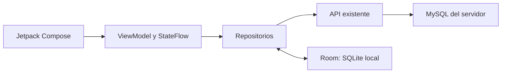

# MVVM y SQLite con Room en FoundIA

Implementación exclusiva de la rama `mobile/android`. No se cambian MySQL, el
backend ni las ramas del equipo. Esta entrega aplica el apartado 10 de arquitectura;
no declara completas todas las historias funcionales del documento de contexto.

## Flujo real de datos



- `model/` conserva los DTO existentes; `domain/` contiene estado de lectura,
  errores y validaciones puras, sin dependencias de la interfaz.
- `data/local/entity` y `dao`: entidades Room y consultas suspendidas/Flow.
- `data/local/FoundIADatabase.kt`: instancia local `foundia-local.db`, versión 2.
- `data/repository`: coordinación de la API con la caché. Solo aquí se decide
  cuándo una copia puede mostrarse y cuándo se debe invalidar.
- `ui/viewmodel`: carga, validación, errores, reenvíos, confirmaciones y acciones.
  Cada pantalla recibe su ViewModel por la factoría de `di/Contenedor.kt`.
- `ui/screens`, `ui/sprint` y `navigation`: presentación y observación con
  `collectAsStateWithLifecycle`; no acceden a Retrofit, DAO ni Room.
- `FoundiaApplication` inicializa la sesión segura y el contenedor. Se conservan
  el paquete `com.proyectointegrador.movil` y las pantallas existentes.

Los efectos de plataforma permanecen en la vista: navegar o abrir el selector de
compartir después de que el ViewModel proporcione el resultado. No ejecutan allí
consultas ni llamadas de negocio. No hay ViewModels con referencias a Activity.

## Qué se almacena en SQLite

Solo publicaciones públicas ya consultadas, sus metadatos públicos y categorías.
La caché está limitada a 200 publicaciones y 20 consultas exactas; caduca a las
24 horas. No se guarda una copia completa de MySQL ni el contenido binario de las
fotos. Las claves de búsqueda se resumen con SHA-256 para no almacenar el texto
escrito por la persona en las claves de consulta.

No hay tablas locales de usuarios, JWT, contraseñas, bandejas, denuncias ni perfiles.
El JWT sigue cifrado mediante Android Keystore/AES-GCM, fuera de Room, con backup
Android deshabilitado. Las contraseñas y los formularios privados solo viven en
memoria del ViewModel; no se agregaron a SavedStateHandle o a la base local.

Room no usa `allowMainThreadQueries` ni migraciones destructivas. Las consultas
son suspendidas o Flow, la escritura agrupada usa transacciones y la serialización
se ejecuta en IO. La migración `MIGRACION_1_2` añade la caducidad conservando las
filas y los esquemas exportados 1 y 2 quedan versionados en `app/schemas/`.

## Política de sincronización

1. Consultar primero la API. Solo errores de conexión o HTTP 5xx permiten mostrar
   una copia exacta y vigente; la pantalla indica «Sin actualizar» y ofrece reintento.
2. Un 401/403/404 no se resuelve con una copia anterior. Se retira el dato/consulta
   correspondiente para no mostrar información retirada como si fuera accesible.
3. Conservar los IDs y el orden de la consulta evita mezclar filtros o duplicar
   objetos. No se guarda como completa una respuesta truncada por el límite local.
4. Publicar, editar, eliminar, descartar y recuperar requieren respuesta satisfactoria
   de la API. No hay cola de escrituras offline ni mensajes de éxito por guardar en Room.
5. Después del éxito remoto se invalida la caché de publicaciones. Una respuesta
   anterior a esa invalidación no puede reescribir datos antiguos.
6. Los ViewModels cancelan consultas anteriores; un cambio de sesión descarta
   respuestas privadas tardías. El estado público de sesión no expone el JWT a Compose.

La base compartida sigue siendo MySQL. Android y la web consumen la misma API;
SQLite no sustituye al servidor y las operaciones privadas requieren conexión.
Las fotos siguen usando Coil con las URL del contrato existente.

## Verificación

- Pruebas unitarias: contratos existentes, caché exacta, 401/403/404, errores,
  cancelación, búsquedas superpuestas, sesión cambiada, aceptación, formularios,
  reenvío con reloj controlado y preferencias.
- Android real: persistencia al reabrir, actualización sin duplicados, migración
  1→2, caducidad y límites de Room. Un caso adicional usa la API existente y MySQL QA.
- Web: publicación, edición, recuperación y eliminación originadas en Android
  contrastadas desde un navegador sin sesión.
- Interfaz: caché visible con la API QA detenida y conservada después de detener
  y reabrir el proceso, con aviso de copia sin actualizar.

Resultados de esta ejecución en `qa/evidencias/`; la matriz funcional más amplia
está en `REPORTE_MOVIL_FOUNDIA.md`, local e ignorada por Git.

## Compilar y abrir en Android Studio

Abrir esta carpeta `movil/android`, sincronizar Gradle y elegir JDK 17 para Gradle.
Se comprobó Kotlin 2.1.20, KSP 2.1.20-2.0.1, Room 2.7.2, AGP 8.10.1 y SDK 36.
No es necesario instalar SQLite por separado en el teléfono.

```powershell
# Desde movil/android
.\gradlew.bat :app:testDebugUnitTest :app:assembleDebug :app:lintDebug
```

Configuración habitual del emulador: API `http://10.0.2.2:8081/`, web
`http://10.0.2.2:5173/`. Para otro equipo, recompilar con `-PfoundiaApiUrl=.../`
y `-PfoundiaWebUrl=.../`. El APK local queda en `output/FoundIA-MVVM-Room.apk`.

En Android Studio: Settings → Build, Execution, Deployment → Build Tools → Gradle →
Gradle JDK: seleccionar Java 17. No se versionan rutas de JDK propias de una máquina.

## QA aislado, sin afectar al equipo

`qa/compose.yml` crea solamente MySQL :13370 y correo :11370/18370 de pruebas.
La API es una copia del JAR ya existente, ejecutada en :18083, sin editar o recompilar
el backend. La web existente se sirve en :15176, con API :18083. Este entorno
no sustituye a los servicios compartidos :3306/:8081.

Compilar el APK QA con `-PfoundiaApiUrl=http://10.0.2.2:18083/` y
`-PfoundiaWebUrl=http://10.0.2.2:15176/`. Instalarlo y ejecutar su APK de pruebas
solo en un emulador dedicado. La prueba `BackendRoomTest` exige además el
argumento de instrumentación `probarApiReal=true` y verifica ese origen exacto.

`qa/verificar_web.cjs` comprueba los resultados en la web. Después se detiene
**únicamente** el proceso de la API QA y `qa/verificar_cache_emulador.py` verifica
el emulador dedicado 5560, marcado con `debug.foundia.qa_room=20261027`. Este
script no instala, no borra datos ni opera sobre el emulador personal 5554.
`qa/verificar_arquitectura.py` revisa las fronteras y que los cambios estén limitados
a `movil/android`. Al terminar se detienen solo los servicios temporales de QA.

Referencias: [arquitectura Android](https://developer.android.com/topic/architecture/recommendations),
[Room 2.7.2](https://developer.android.com/jetpack/androidx/releases/room#2.7.2) y
[migraciones Room](https://developer.android.com/training/data-storage/room/migrating-db-versions).
